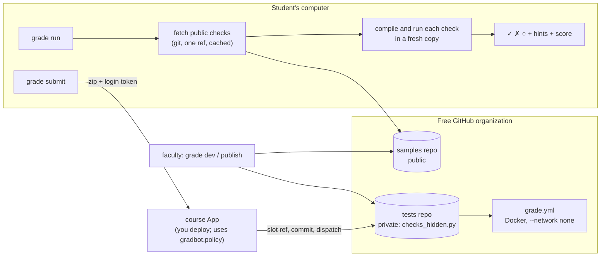

# GradBot

**An autograder for programming courses that runs on a free GitHub organization, and keeps hidden tests off students' machines.**

[](https://github.com/nvmaditya/gradbot/actions/workflows/ci.yml)
[](LICENSE)
[](pyproject.toml)
[](https://docs.astral.sh/ruff/)
[](https://mypy-lang.org/)

<!--
TODO(demo): replace this comment with docs/demo.gif (about 15 s, 100x30 terminal, dark theme).
Capture, from a folder holding the Two Sum sample solution:
  1. `grade run arrays/two_sum`          -> four green checks, "Score: 4 / 4", "Accepted."
  2. edit the print to `print(i, seen[complement])` (indexes swapped)
  3. `grade run arrays/two_sum`          -> red check with its hint, skipped dependents, "Score: 0 / 4"
  4. `grade run arrays/two_sum --verbose` -> the expected vs actual line under the failure
Then: 
-->

```text
$ grade run arrays/two_sum
Practice runs on this computer. The submit machine may differ.

Grade — Arrays & Strings: Two Sum
─────────────────────────────────────────────

  ✓  Basic case: [2,7,11,15], target=9        (1 pt)
  ✓  Negative numbers work                    (1 pt)
  ✓  Duplicate values                         (1 pt)
  ✓  Large input performance                  (1 pt)

─────────────────────────────────────────────
  Score: 4 / 4   ██████████  100%

  Accepted. All tests passed.
```

## Why this exists

Autograders tend to force a choice. Ship the tests to students and they can
read the answers; keep them on a server and someone has to pay for, run and
secure that server. Classroom 50, an open-source GitHub Classroom
alternative, needs a GitHub Team or Enterprise organization and publishes through GitHub Pages
([research notes](docs/research/classroom50-architecture.md)).

GradBot splits each problem in two. Public sample checks go to students, who
run them locally as often as they like. Hidden checks stay in a private repo
and run in a no-network container, on the free GitHub Actions minutes of the
course's own organization. Students get one graded submit per problem,
enforced by a git ref, and see pass/fail and hints, never the expected
output.

**Status.** Practice, faculty `dev` and `publish`, all four languages, and
the submit client and rules are tested end to end, against a fake GitHub and
local git repos, and practice also against the real GitHub. Two pieces have
not run live yet: the grader workflow has never been dispatched on GitHub,
and the course App that receives submits is yours to deploy. Details are in
[VERIFICATION_REPORT.md](VERIFICATION_REPORT.md).

## Features

- **Write checks in plain Python.** `@gradbot.check`, `gradbot.run()`,
  `expect_output()`, with dependencies between checks and per-check hints.
- **Grades Python, C, C++ and Java.** Compile errors are reduced to "error on
  line N", with the raw compiler output behind `--verbose`.
- **Practice anywhere.** `grade run topic/problem` fetches only the public
  checks (any branch, tag or commit), caches them, and works `--offline`.
- **Hidden checks stay hidden.** Student runs refuse `checks_hidden.py`.
  `grade publish` splits a problem into a private tests tree and a public
  samples tree. Student-facing JSON drops expected output.
- **Faculty loop.** `grade dev` runs public then hidden checks and says which
  set failed. `--output` and `--student-output` write both views.
- **Safe execution.** Every check runs in a fresh copy. The program never sees
  tokens from the environment. In the grader it runs in Docker with no
  network, resource limits and no root.
- **One graded submit.** GitHub device login (`read:user` only), source-only
  zips sent over HTTPS, a roster keyed by GitHub's numeric id, and faculty
  `reset` for a second chance. You deploy the small course App that receives
  submits; its rules ship here as `gradbot.policy.accept_zip`. See the
  [faculty guide](docs/faculty-guide.md).
- **Clear failures.** Missing config, a broken `suite.yaml`, a missing repo or
  ref, or a dead network each get a message that says what to do. Never a
  traceback.

## Quickstart

macOS or Linux, with Python 3.10+ and Git:

```bash
git clone https://github.com/nvmaditya/gradbot && cd gradbot
python3 -m venv .venv && source .venv/bin/activate
pip install .
grade dev problems/arrays/two_sum --solution problems/arrays/two_sum/sample_solution
cd problems/arrays/two_sum/sample_solution && grade run arrays/two_sum
```

The fourth line grades the bundled sample solution against the bundled
checks, offline. The fifth fetches the public demo course from GitHub and
grades the same solution as a student would.

Next: the [student guide](docs/student-guide.md),
the [faculty guide](docs/faculty-guide.md),
and [writing a problem](docs/problem-authoring.md).

## How it works



The module-by-module walk-through, the error model and the trust
boundaries are in [docs/architecture.md](docs/architecture.md).

## Configuration

GradBot reads environment variables only. [`.env.example`](.env.example)
lists each one with whether it is required.

| Variable | Needed by | Default |
|---|---|---|
| `GRADBOT_PUBLIC_REPO` | `grade run` | `nvmaditya/gradbot-course-samples` (the demo course). `owner/repo`, a git URL, or a path. |
| `GRADBOT_LOCAL_DIR` | `grade run` | `~/.gradbot/local` |
| `GRADBOT_CONFIG_DIR` | `grade login`, `grade submit` | `~/.gradbot` |
| `GRADBOT_CLIENT_ID` | `grade login` (required) | — |
| `GRADBOT_SUBMIT_URL` | `grade submit` (required, https) | — |
| `GRADBOT_APP_TOKEN` | `grade roster add`, `grade reset` (required) | — |
| `GRADBOT_SUBMISSIONS_REPO` | `grade reset` (required) | — |
| `GRADBOT_GITHUB_URL`, `GRADBOT_GITHUB_API_URL` | login, roster, reset | github.com (set both for GitHub Enterprise Server) |
| `NO_COLOR` | everything | — |

A missing required variable stops the command with its name and what it is
for. A malformed one (for example `GRADBOT_PUBLIC_REPO=not a repo`) is refused
the same way.

## Commands

| Command | |
|---|---|
| `grade run topic/problem[@ref]` | Practise against the public checks. |
| `grade dev PROBLEM_DIR --solution DIR` | Faculty: public checks, then hidden checks. |
| `grade publish PROBLEM_DIR --tests T --samples S --slug topic/problem` | Faculty: split into the two repos and write `grade.yml`. |
| `grade login` / `grade submit topic/problem` | The one graded submit. |
| `grade roster add LOGIN --roster roster.yml` | Faculty: enrol by GitHub's numeric id. |
| `grade reset LOGIN topic/problem` | Faculty: one more submit. |
| `grade results FILE` | Print a result without hidden detail. |
| `grade course …`, `grade assignment …` | Classroom files for the course-repo design (preview). |

`grade COMMAND --help` lists each command's options. `GradBot` and
`python -m gradbot` start the same program.

## Testing

```bash
pip install -e ".[dev]"
pytest                                   # offline suite: unit, integration, end to end
pytest --cov                             # with line and branch coverage
ruff check gradbot tests && mypy         # lint and types
pytest -m docker                         # the Docker sandbox (needs a Docker daemon)
GRADBOT_LIVE=1 pytest -m live            # smoke tests against the real GitHub
```

The default run needs no network and no secrets. GitHub, the course App and
the samples repo are replaced by a local HTTP server and bare git repos on
disk, so the tests are deterministic and free. End-to-end tests drive the
installed `grade` command as a subprocess through every main flow, including
login, submit, a refused second submit, reset, and submit again. Language
tests compile and run real C, C++ and Java, and skip with a reason if a
toolchain is missing. CI requires them.

The CI workflow runs lint, types and the suite on Python 3.10–3.14 (Ubuntu)
and 3.12 (macOS), the Docker tests against a real daemon, and a clean wheel
install.
What has and has not been verified, with the test for each feature, is in
[VERIFICATION_REPORT.md](VERIFICATION_REPORT.md).

## Roadmap

Planned, not built:

- **Reference course App.** A small deployable service around
  `gradbot.policy.accept_zip` with a GitHub client, so graded submits work
  without writing your own. The in-memory App in `tests/test_e2e.py` is the
  starting point.
- **Course repo on a free organization** ([spec](docs/design/course-repo-spec.md)):
  staging the course tree, creating the private repo with a $0 Actions cap,
  team invites by GitHub id, starter repos, tag-based submits, a score book,
  and a static classroom page. Classroom files and the workflow text, its
  first two steps, are built.
- **Memory limits** in local runs (`problem.memory_limit_mb`). The Docker
  sandbox already caps memory at 512 MB.
- **Windows in CI.** The code has Windows branches, but no Windows run has
  been verified.
- **Output size cap** for programs that print without end before their
  timeout.
- **Faculty authoring prompt** ([design](docs/design/faculty-authoring-prompt.md)):
  a prompt that turns a question into problem files in any chat.

## Credits

Built by Aditya Khandelwal. The course-repo design learned from
[Classroom 50](https://github.com/foundation50/classroom50)'s architecture
([research notes](docs/research/classroom50-architecture.md)); no Classroom 50
code is used. YAML parsing by [PyYAML](https://pyyaml.org/).

GradBot is free software under the [GNU GPL v3.0 only](LICENSE). See
[CONTRIBUTING.md](CONTRIBUTING.md) and the [CHANGELOG](CHANGELOG.md).
