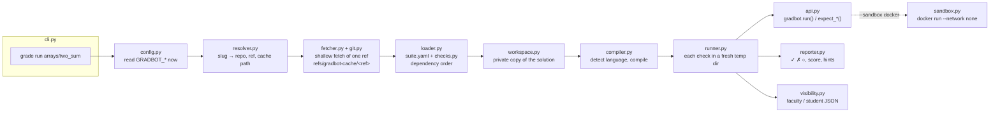
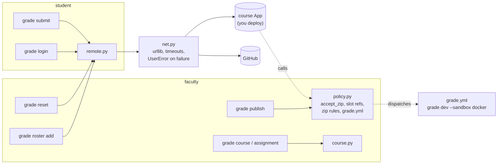
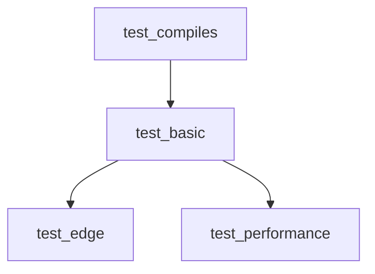

# Architecture

GradBot is one Python package (`gradbot`) with one runtime dependency
(PyYAML). Everything else is the standard library plus the `git`, compiler
and (for the grader) `docker` programs.

## A practice run, end to end



1. **`cli.py`** parses the command and owns the one top-level error handler.
2. **`config.py`** reads every `GRADBOT_*` variable when the command runs, and
   refuses malformed ones by name.
3. **`resolver.py`** turns `practice/topic/problem[@ref]` into a repo, a ref
   and a cache folder. `owner/repo` means GitHub over HTTPS; a URL or
   absolute path is used as given.
4. **`fetcher.py` and `git.py`** shallow-fetch exactly that ref into
   `refs/gradbot-cache/<ref>` and check it out. A network failure falls back
   to the cached copy of the same ref; a missing repo or ref never does. A
   failed first fetch removes the folder it created.
5. **`loader.py`** parses `suite.yaml`, imports `checks.py` (without writing
   bytecode next to it), collects the `@gradbot.check` functions, and orders
   them with Kahn's algorithm. Duplicate names, unknown dependencies and
   cycles are load errors.
6. **`workspace.py`** copies the student's folder (without dotfiles or
   `__pycache__`) to a private stage, so compilers never write into it.
7. **`compiler.py`** picks the language from the extensions, checks Python
   syntax with `compile()`, and builds C, C++ and Java. Errors are reduced
   to "error on line N".
8. **`runner.py`** runs each check in its own temp copy of the stage, skips a
   check whose dependency did not pass, and turns every outcome, including
   a crash in the check itself, into a `CheckResult`.
9. **`api.py`** is what `checks.py` calls. `run()` starts the program with
   UTF-8 stdio, a timeout, and an environment without tokens.
10. **`reporter.py`** prints the result. **`visibility.py`** produces the
    faculty JSON and the student JSON (no `cause`, no `log`).

`grade dev` is the same pipeline from a local folder, run twice: once for
`checks.py` and once for `checks_hidden.py`.

## The other commands



| Module | Responsibility |
|---|---|
| `remote.py` | `login` (device flow), `submit` (source files only, HTTPS only), `roster add`, `reset`, `results`. |
| `net.py` | One `request()` over `urllib`; network failures and unusable replies become `HttpError`. |
| `policy.py` | The submit rules: roster by numeric id, one slot ref per student and problem, zip checks, rollback on failure. Also the publish split and the `grade.yml` template. No network of its own: the caller passes an `ops` object. |
| `course.py` | Classroom, roster CSV, assignment and test files for the course-repo design. |
| `grade_workflow.py` | The course-repo version of the grader workflow (not reachable from the CLI yet). |
| `errors.py` | `UserError`: an error whose message is for the person at the keyboard. |

## Errors

Every error a user can cause or fix (bad config, missing repo, broken
`suite.yaml`, a GitHub refusal, a network failure) is a `UserError`
subclass. `cli.main` prints its message after `❌` and exits 1. Anything else
is a bug: the handler prints "GradBot ran into an unexpected problem" and the
error, with the traceback only under `--verbose`. Output streams are set to
replace characters the terminal can't encode, so even that message prints on
an ASCII console.

Inside a run, nothing a check does can crash GradBot: a failed expectation
is `fail`, an exception in the check is `error`, and a compile failure skips
every check.

## Trust boundaries

| Boundary | How it is kept |
|---|---|
| Hidden checks never reach a student | `grade run` refuses a suite or solution folder containing `checks_hidden.py`; `publish` copies it to the tests tree only and refuses a samples tree that has one; student JSON drops `cause` and `log`; assert messages never become hints. |
| Student code can't read secrets | The child environment drops names containing TOKEN, SECRET, PASSWORD, CREDENTIAL, API_KEY or PRIVATE_KEY. The grader workflow also clears its tokens, and Docker passes no host environment. |
| Student code can't reach the network (grader) | `docker run --network none`, one mount, memory, pid and CPU limits, `no-new-privileges`, non-root. |
| A student can submit only once | The slot ref `refs/gradbot/slots/<slug>/<id>` is created atomically before anything else; the id comes from GitHub, never from the request. |
| Tokens stay put | The login token is stored mode 0600 outside the solution folder and sent only over HTTPS. git never prompts for credentials. |

## Check dependency graph

```python
@gradbot.check("Compiles", points=0)
def test_compiles(): ...

@gradbot.check("Basic case", depends_on="test_compiles")
def test_basic(): ...

@gradbot.check("Edge case", depends_on="test_basic")
def test_edge(): ...

@gradbot.check("Performance", depends_on="test_basic")
def test_performance(): ...
```



If `test_basic` fails, `test_edge` and `test_performance` are skipped.
Independent checks keep their declaration order.
